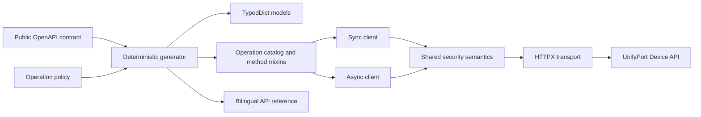

# Architecture

[English](architecture.md) | [简体中文](zh-CN/architecture.md)

The Python SDK has one protocol source and two runtime front ends:

## Source boundaries

- `contracts/device.openapi.yaml` is the only protocol input. It is frozen from the public Node SDK
  `v0.4.0` contract, not from an internal service repository.
- `policy/operation-policies.json` records retry, mutability, secret, header, and Node MCP parity facts
  that cannot be inferred safely from OpenAPI alone.
- `parity/source.json` pins the upstream tag, commit, contract digest, and expected surface counts.
- `scripts/generate.py` owns everything marked generated, including the operation catalog, models,
  sync/async method mixins, parity manifest, and operation reference pages.

## Public runtime

`UnifyPortDeviceClient` and `AsyncUnifyPortDeviceClient` expose the same 64 snake_case methods. Generated
methods translate Python input locations into one internal execution call; the clients do not build
protocol paths by hand. The runtime then validates URL confinement and inputs, resolves the API key,
applies the operation policy, sends the request, bounds the response, parses JSON, and returns filtered
metadata.

The sync and async implementations intentionally share behavior rather than sharing an `httpx.Client`.
Each owns the transport appropriate to its execution model and supports its matching context manager.

## Type boundary

Generated schemas use Python 3.11 `TypedDict`, `Literal`, and type aliases, so applications receive static
types without a mandatory model-validation dependency. Runtime data remains ordinary JSON-compatible
Python values. `ProviderProfile` uses the PEP 728 `extra_items=JsonValue` backport: known fields retain
their precise types while provider-specific keys remain open and JSON-typed. Pyright verifies this public
surface. Mypy 2.3 validates the known fields but does not yet implement `extra_items`; mypy consumers need
a temporary `Mapping[str, JsonValue]` cast when directly accessing extension keys.

Python integers are arbitrary precision. Unlike JavaScript, the SDK does not rewrite valid JSON integer
tokens into strings merely because they exceed IEEE-754's safe range. Fields declared as strings in the
public contract remain strings.

## Deliberate differences from the Node SDK

- Python methods use snake_case and retain a generated mapping to camelCase OpenAPI `operationId` values.
- Both sync and async clients are public; the Node client is promise-based.
- `ApiResult` does not expose a raw response object.
- Python does not ship the Node repository's MCP server or Agent Skills.
- There is no generic raw-request method that can bypass operation policy.
