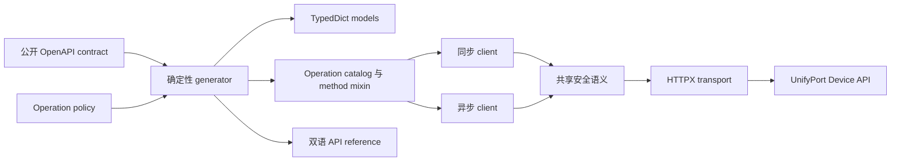

# 架构

[English](../architecture.md) | [简体中文](architecture.md)

Python SDK 只有一个协议来源，并提供两个 runtime 前端：

## 来源边界

- `contracts/device.openapi.yaml` 是唯一协议输入。它冻结自公开 Node SDK `v0.4.0` contract，而不是
  内部 service repository。
- `policy/operation-policies.json` 保存无法从 OpenAPI 安全推导的 retry、mutability、secret、header
  和 Node MCP parity 信息。
- `parity/source.json` 固定 upstream tag、commit、contract digest 和预期 surface 数量。
- `scripts/generate.py` 负责所有 generated 文件，包括 operation catalog、models、同步/异步 method
  mixin、parity manifest 和 operation reference 页面。

## 公开 runtime

`UnifyPortDeviceClient` 与 `AsyncUnifyPortDeviceClient` 提供相同的 64 个 snake_case method。generated
method 将 Python 输入位置转换为一次内部 execution call；client 不手写协议 path。runtime 随后校验 URL
边界和输入、解析 API key、应用 operation policy、发送请求、限制 response、解析 JSON，并返回经过筛选的
metadata。

同步与异步实现有意共享行为，而不共享一个 `httpx.Client`。两者分别持有适合自身 execution model 的
transport，并支持对应的 context manager。

## 类型边界

generated schema 使用 Python 3.11 `TypedDict`、`Literal` 和 type alias，因此 application 无需强制
model-validation dependency 也能获得静态类型。runtime data 仍是普通 JSON-compatible Python value。
`ProviderProfile` 通过 PEP 728 `extra_items=JsonValue` backport 同时提供精确的已知字段类型和开放、
JSON-typed 的 provider-specific key，并由 Pyright 验证 public surface。Mypy 2.3 尚未实现
`extra_items`；mypy consumer 直接访问 extension key 时，需要临时 cast 为 `Mapping[str, JsonValue]`。

Python integer 支持任意精度。与 JavaScript 不同，SDK 不会仅因合法 JSON integer 超出 IEEE-754 safe
range 而把它重写成 string；公开 contract 中声明为 string 的字段仍保持 string。

## 与 Node SDK 的有意差异

- Python method 使用 snake_case，并保留到 camelCase OpenAPI `operationId` 的 generated mapping。
- 同步和异步 client 都是 public；Node client 使用 Promise。
- `ApiResult` 不公开 raw response object。
- Python 不发布 Node repository 中的 MCP server 或 Agent Skills。
- 不提供可以绕过 operation policy 的通用 raw-request method。
